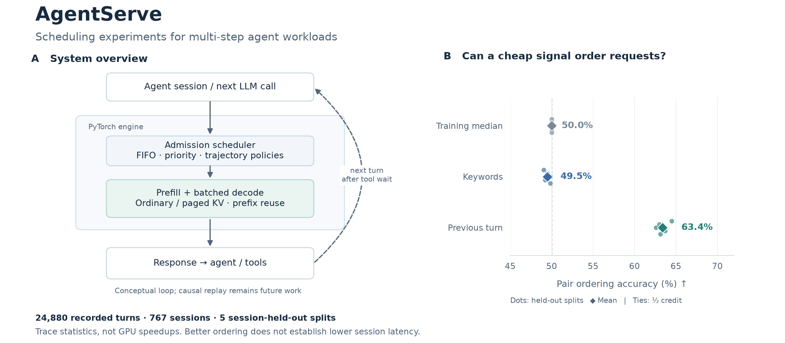

# AgentServe

An experimental PyTorch inference engine for studying scheduling in multi-step
agent workloads: continuous batching, grouped-query Llama attention, ordinary and
paged KV storage, prefix reuse, and request/trajectory scheduling policies.



*Conceptual agent loop and recorded trace statistics. Dots show five held-out
splits; diamonds show their means. These are not GPU or session-latency results.*

## Research question

Can inexpensive signals help a scheduler finish agent sessions sooner, without
unfairly delaying long requests? Agent sessions alternate LLM calls and tools, so
improving individual request latency may not improve whole-session completion.
The engine implements FIFO, priority, overflow, preemption, relative batching,
and trajectory progress/deadline heuristics for investigating this question.

## Experiment: output-length signals

**24,880 recorded turns, 767 sessions, four models.** Five seeded 80/20 splits
keep each session entirely in training or test. Compare a training-set median,
the existing keyword heuristic, and the previous observed output in the same
session (training median on its first turn).

| Predictor | Token-count MAE ↓ | Pair ordering accuracy ↑ |
|---|---:|---:|
| Training median | 144.49 | 50.00% |
| Keywords | 147.66 | 49.48% |
| Previous turn | 164.43 | 63.36% |

Values average five splits. Ordering samples 20,000 pairs per split, excluding
same-session pairs and equal output lengths; prediction ties receive half credit.
Keywords tie on 88.71% of evaluated pairs. Previous-turn length ranks better
despite worse absolute error: **calibration and ordering are different objectives.**
This identifies a candidate signal, not a validated scheduling improvement.

Raw predictions, exact session splits, dataset SHA-256, session-weighted errors,
and session-bootstrap intervals are in `experiments/length_prediction/`.
Overlapping splits are not independent replications. Prompts are truncated last
user/tool messages; model-specific token counts and related tasks limit generalization.
The extract has no pinned upstream revision.

## Reproduce

Python 3.11+; Transformers is pinned to the tested 4.48.3 reference.

```bash
python -m pip install -e '.[dev]'
python -m pytest -q
python scripts/study_lengths.py
python scripts/plot_overview.py
```

The trace study needs no GPU or model download. Input is tracked at
`notes/lmcache_lmcache_787_pairs.jsonl` (767 sessions despite its filename).
`agentserve/model/` contains inference, `agentserve/engine/` scheduling and caches,
and `agentserve/server/` the experimental HTTP interface.

## Validation and limits

CPU regression tests cover repeated mixed-length decoding, ordinary/paged KV
contents, tiny Hugging Face parity, scaled RoPE around position 8192, deadline
refresh, and leakage checks. Random-weight tests do not establish pretrained or
CUDA parity. To check an accessible local checkpoint:

```bash
python scripts/validate_checkpoint.py /path/to/checkpoint --device cuda --out /tmp/parity.json
```

This checks float32 prefill logits and eight mixed-length batched decode steps.
It was smoke-tested with synthetic weights; intended Llama checkpoint access is
gated. **Pretrained parity and current GPU speedups remain unvalidated.**

Old JSON results and PNGs under `notes/` predate correctness fixes and require
reruns. The terminal demo uses a mock model and artificial delays. Existing trace
replay fixes arrivals using a two-second generation estimate; it does not measure
causal session completion. New conversions preserve dependencies and tool gaps,
but no causal replay result is claimed.

Next: validate pretrained inference, then compare policies with identical initial
session arrivals and causal tool waits. Measure session completion, long-request
tails, and fairness across burstiness, concurrency, context growth, and prefix reuse.

Data: [LMCache agentic traces](https://huggingface.co/datasets/DiscoPosse/lmcache-agentic-traces)
(CC BY 4.0); the original converter names a different upstream namespace.
[TraceLab](https://arxiv.org/abs/2606.30560) motivates the workload dimensions.
Development used substantial Claude Code and Codex assistance.
